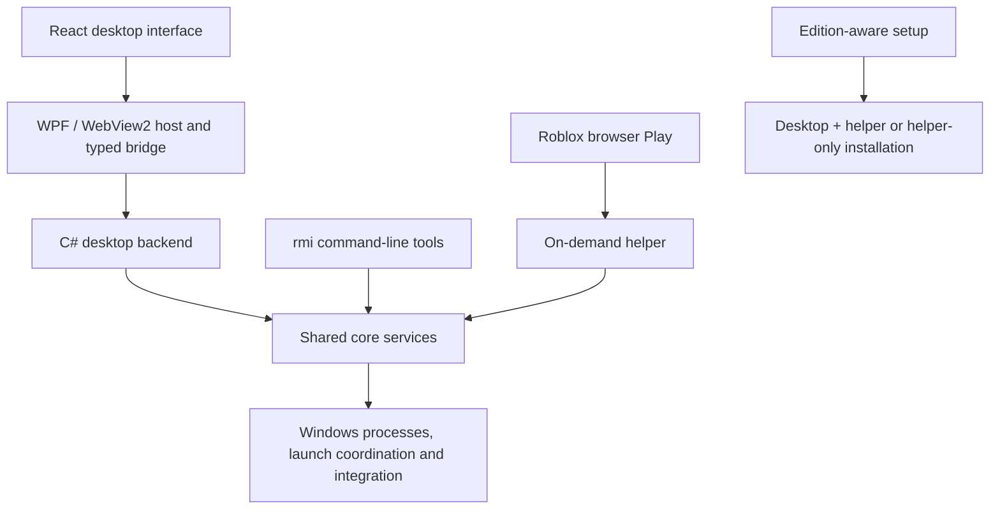

<div align="center">

# Roblox Multi Instance

A Windows workspace for launching, monitoring, and managing multiple Roblox clients.

[](https://github.com/LancePerdue23/roblox-multi-instance/releases)
[](https://github.com/LancePerdue23/roblox-multi-instance/releases)


**[Download App + Helper](https://github.com/LancePerdue23/roblox-multi-instance/releases/download/v1.2.0/RobloxMultiInstance-Setup.exe)** · [Helper only](https://github.com/LancePerdue23/roblox-multi-instance/releases/download/v1.2.0/RobloxLaunchHelper-Setup.exe) · [Portable ZIP](https://github.com/LancePerdue23/roblox-multi-instance/releases/download/v1.2.0/RobloxMultiInstance-Portable.zip) · [All releases](https://github.com/LancePerdue23/roblox-multi-instance/releases)

</div>

## Table of contents

- [What is Roblox Multi Instance?](#what-is-roblox-multi-instance)
- [Features](#features)
- [Getting started](#getting-started)
- [Which download do I need?](#which-download-do-i-need)
- [FAQ](#faq)
- [Architecture](#architecture)
- [Technology stack](#technology-stack)
- [Repository layout](#repository-layout)
- [Development](#development)
- [Testing and packaging](#testing-and-packaging)
- [Data and optional services](#data-and-optional-services)
- [Further documentation](#further-documentation)
- [License and reporting](#license-and-reporting)

## What is Roblox Multi Instance?

Roblox Multi Instance combines a graphical desktop workspace with an on-demand Windows launch helper. The desktop provides instance visibility, launch activity, account organization, game targets, performance monitoring, and maintenance tools. The helper handles browser Play integration and coordinates the shared launch services.

Choose the **App + Helper** edition for the complete workspace. Choose **Helper only** if you want browser Play integration and terminal commands without the desktop interface. Both editions include the `rmi` command-line tools.

The current releases are prereleases. Experimental features and live-game verification limits are described below; implementation and automated tests do not establish compatibility with every Roblox update or Windows configuration.

## Features

| Area | What is included |
| --- | --- |
| Launch coordination | Launch games with repeat/edit/review, ordered account batches, automatic layouts, on-demand helper, browser Play integration, and startup diagnostics. |
| Instances | Running-client visibility, validated focus/close actions, confirmed Stop all, and a live preview grid with pause, privacy, fit, density, and retry controls. |
| Activity | Launch history and diagnostics, independent of whether previews are enabled. |
| Accounts | Local sign-in profiles, guided signup, protected supplied credentials and recovery, groups, notes, colors, favorites, and saved ordering. |
| Games | Game target validation, artwork, recent games, and remembered ordered account/layout setups. |
| Performance | Per-process CPU, working set, private commit, uptime, and I/O monitoring; history, saved profiles, and explicit CPU priority/EcoQoS controls where supported. |
| Maintenance | Installation health, repair/recovery, browser integration settings, report export, and uninstall tools. |
| Terminal | Interactive `rmi` menu, direct commands, and structured `--json` results for scripts. |
| Privacy and support | Optional error reporting, off by default, plus cosmetic supporter receipt support when configured. Features remain free. |

**Testing scope:** focused live checks have been completed for the current validation release. Wider Windows installation/update and hardware acceptance remains separate. Verify actual accounts and game outcomes before relying on unattended batches. Preview capture is experimental. Saved FPS and graphics preferences do not currently change Roblox clients; performance profiles do not promise RAM savings. CPU priority and EcoQoS behavior depends on Windows support and process permissions.

## Getting started

### 1. Check requirements

- Windows 10 or Windows 11 on an x64 PC. Windows/GPU compatibility testing is still in progress.
- Roblox Player installed for the Windows account you will use.
- Microsoft Edge WebView2 Evergreen Runtime for the graphical desktop.

Release packages include the .NET runtime. Node.js and the .NET SDK are development requirements, not prerequisites for using the packaged app.

### 2. Install the recommended edition

1. Open the [App + Helper release](https://github.com/LancePerdue23/roblox-multi-instance/releases/tag/v1.2.0).
2. Download and run **`RobloxMultiInstance-Setup.exe`**.
   Published validation packages are unsigned and may show **Unknown publisher**. Obtain them from the linked release and compare SHA-256 checksums; checksums establish integrity, not an independent publisher identity.
3. Review the browser Play integration option during setup. It is enabled by default on a fresh installation; upgrades retain your preference.
4. Open Roblox Multi Instance and check **System → Health** for installation or helper issues.
5. With browser integration enabled, use **Play** on Roblox as usual. Use Instances and Activity to inspect clients and launch outcomes.

The full installer includes the matching helper and CLI. You do not also need the helper-only installer. Ordinary desktop startup does not install the helper automatically.

For **Helper only**, run the linked `RobloxLaunchHelper-Setup.exe` instead, review browser integration during setup, then use browser Play or `rmi` in a new terminal. For **Portable**, extract the entire ZIP to a writable folder and run `RobloxMultiInstance.exe`; use System → Health for explicit helper setup before launching games.

### 3. Optional: use the terminal

Open a **new terminal after installation** so it picks up the registered `rmi` command:

```powershell
rmi
rmi --help
rmi status
rmi diagnostics
```

Bare `rmi` opens an interactive menu. Browser Play integration works without keeping that menu open. See the [CLI guide](docs/helper-cli.md) for details.

## Which download do I need?

Download **one main package** for the edition you want:

| Release asset | Purpose |
| --- | --- |
| **`RobloxMultiInstance-Setup.exe`** | **Recommended:** installs the desktop, matching helper, and CLI together. |
| `RobloxMultiInstance-Portable.zip` | Extract and run the desktop with its entire folder intact. Browser integration and launch/maintenance still need the matching installed helper; use explicit setup through System → Health. The ZIP includes the matching full setup. |
| `RobloxLaunchHelper-Setup.exe` | Available in the separate helper-only release. Installs the on-demand helper and CLI without desktop assets. |
| `*.sha256` | Optional checksum for the matching download. |
| `SHA256SUMS.txt` | Combined checksums for the release's packages and metadata. |
| `assets.json` | Version, edition, size, hash, and payload metadata used by update tooling. No manual installation required. |
| `Source code (zip)` / `Source code (tar.gz)` | GitHub-generated source archives for developers, not runnable app packages. |

To check a download, compare its SHA-256 result with its published checksum:

```powershell
Get-FileHash .\RobloxMultiInstance-Setup.exe -Algorithm SHA256
```

## FAQ

### Do I need both installers?

No. App + Helper already contains the helper and CLI. Helper only is an alternative edition for people who do not want the graphical workspace.

### Is the CLI a separate edition?

No. Both installer editions include `rmi`. Helper only also handles browser launches; it is not limited to terminal use.

### Must I uninstall before every update?

No. Same-edition upgrades are designed to preserve settings, launch history, and integration preferences. Uninstall first when **switching between App + Helper and Helper only**. Downgrades are rejected. Uninstall retains user data by default unless you explicitly choose removal.

### How should I update right now?

For the v1.2.0 validation prerelease, use the edition links above and run the installer manually. There is no stable release yet, so an in-app check can correctly report no update. For future stable releases, open System → Version & updates to check public stable releases anonymously, review notes, download and verify the installer, then run setup explicitly. Private releases and validation prereleases are not offered. No GitHub token or browser sign-in is required for public stable updates. See [update behavior](docs/update-checker-validation.md).

The v1.2.0 packages include this updater behavior. Historical v1.1.2 binaries predate those changes; do not configure private update access in those builds. Update manually until a newer stable package is available. If an app-only release omits a helper installer, helper-only users keep the latest applicable helper package.

### Can I use the portable app without installing anything?

You can extract and open the desktop, but launch and maintenance require a matching installed helper. Portable does not make browser integration installation-free. Use System → Health to run setup explicitly.

### Does the helper stay running all the time?

Helper-only browser launches are windowless and on demand. That edition does not start a resident tray host, automatic update notifications, or resident cleanup. Desktop features may run background work while the app is open.

### Can I automatically launch all saved accounts?

Use Launch games to review and launch selected accounts or repeat a recent setup. The owner completed focused live checks; verify the actual account inside each game and inspect unconfirmed outcomes before retrying. Guided signup still requires you to submit the official form and complete Roblox security challenges.

### Does it unlock FPS or reduce memory automatically?

No such result is promised. Monitoring shows measured resource usage. Supported priority/EcoQoS controls can be applied explicitly; saved FPS/graphics requests remain unapplied preferences.

### Is reporting required? Do features require payment?

No. Technical error reporting is optional and off by default. Default builds have no reporting endpoint or payment configuration. Supporter receipts are cosmetic; features remain free. Saved account sessions are not sent to the developer.

### What should I check when launching fails?

Start with System → Health and Activity, or run `rmi status` and `rmi diagnostics`. Check that Roblox Player is installed, the helper matches the desktop version, and browser integration is enabled if you launch through Play. Use the repair/recovery flow when offered. Review exported diagnostics before sharing them.

## Architecture



The frontend renders the workspace and calls a typed native bridge. The host manages the Windows window, WebView2 lifecycle, native sign-in windows, and preview capture. The backend exposes application operations and coordinates account, game, performance, and support services.

`src/core` owns shared launch, readiness, diagnostics, installation, settings, and update behavior. Both the helper and CLI use that layer. Desktop notification presentation is separate from the shared core. Setup packages edition-specific payloads and validates installation metadata and file manifests.

## Technology stack

| Layer | Technology |
| --- | --- |
| Desktop interface | React 19, TypeScript, CSS |
| Frontend tooling | Vite, npm |
| Windows host | C# / .NET 10, WPF, Microsoft Edge WebView2; Windows Forms for tray interop |
| Shared services, helper, CLI, setup | C# / .NET 10 with Windows APIs |
| Frontend verification | Vitest and Playwright |
| Native verification | .NET fixture projects and PowerShell orchestration |
| Packaging | Self-contained Windows x64 output, embedded edition manifests, ZIP payloads, SHA-256 checksums |
| Optional hosted services | Cloudflare Workers and D1 for configured telemetry/support services |

## Repository layout

```text
src/
  core/                 Shared Windows services and compatibility logic
  helper/               Installed browser/worker helper entrypoint
  cli/                  rmi command-line entrypoint
  setup/                Edition-aware installer
  desktop/
    web/                React interface and browser tests
    host/               WPF/WebView2 host, sign-in and capture
    backend/            Desktop operations and typed contracts
    presentation/       Desktop notification presentation
    *-tests/            Native host and feature fixtures
tests/                  Shared-service fixtures
services/
  telemetry/            Optional technical-report ingestion service
  support/              Optional contribution and receipt service
scripts/                Maintainer and download-count utilities
  testing/              Feature checks, distribution verification, and milestone audit
  legacy/               Historical build/test runners and archive verification
docs/                   Design notes, guides, and acceptance checklists
  assets/branding/      Project logo and app artwork
.github/                Workflows, issue forms, contribution and security policies
```

## Development

Use Windows x64, Node.js/npm, PowerShell, and the .NET 10 SDK. Scripts default to the repository-local SDK at `.build/sdk/dotnet.exe`; supply `-Dotnet` when using another SDK location. The frontend build restores its npm dependencies.

```powershell
./Build.ps1
./Dev.ps1
```

The consistent latest development executable is **`.build/desktop/RobloxMultiInstance.exe`**. Close that development app before rebuilding, and keep its output folder intact. `Build.ps1` builds the desktop; `Dev.ps1` builds and opens it. Neither installs the helper automatically.

To use the CLI from the checkout without installation:

```powershell
./rmi.ps1 --help
```

## Testing and packaging

```powershell
./Test.ps1
./Test-Shared.ps1
./Package.ps1
./scripts/testing/Test-Distribution.ps1
```

- `Test.ps1`: current desktop/native contracts, frontend checks, browser workflows, and account/support/service fixtures.
- `Test-Shared.ps1`: shared helper and service regression fixtures; required when changing the installed helper or shared services.
- `Package.ps1`: fresh staging and both installer editions, portable ZIP, manifests, and checksums under ignored `artifacts/`.
- `scripts/testing/Test-Distribution.ps1`: read-only package hashes, embedded payloads, edition boundaries, and portable contents; does not install or launch Roblox. Pass the version being packaged.

Some native tests need access to temporary registry keys and ACL fixtures. Live Roblox, installation, upgrade, repair, and uninstall acceptance are separate from fixture tests. See the [Windows acceptance checklist](docs/releases/windows-acceptance.md) and [milestone audit](docs/milestone-audit.md).

The historical WinForms reference is local under ignored `archive/legacy-winforms` and is not the current app. `scripts/legacy/VerifyArchive.ps1` checks its hashes when that archive is present. Retired UI tests run only through explicit `scripts/legacy/Test-ArchivedUI.ps1`; they are excluded from normal desktop verification.

## Data and optional services

Desktop preferences live under `%LOCALAPPDATA%/RobloxMultiInstance`. Missing preferences can migrate from Preview without replacing existing primary settings or modifying the originals. Shared helper history and installation identities retain their own existing locations.

Account profiles use local storage and protected session handling. Existing WebView2 browser profiles must not be described as a master-password-encrypted vault. See the [account feasibility and acceptance guide](docs/account-launch-feasibility.md) for boundaries.

The optional telemetry receiving endpoint is configured in `BuildConfig.psd1`; reporting still requires user opt-in. Contribution services require separate maintainer configuration, and repository source alone does not deploy hosted services. Never place credentials or private session data in source control. Public distribution builds exclude machine-local supporter preview tools.

## Further documentation

- [CLI and interactive helper menu](docs/helper-cli.md)
- [Distribution and installation behavior](docs/distribution-preparation.md)
- [Public-release readiness review](docs/public-release-readiness.md)
- [Startup resilience](docs/startup-resilience.md)
- [Launch startup and recovery](docs/launch-startup-recovery.md)
- [Performance implementation and limits](docs/performance-optimizations.md)
- [Live client preview grid](docs/live-client-preview-grid-plan.md)
- [Account launch feasibility](docs/account-launch-feasibility.md)
- [Game library and account batches](docs/multilaunch-game-library.md)
- [Telemetry and download counts](docs/telemetry.md)
- [Supporter service setup](docs/supporter-setup.md)
- [Changelog](CHANGELOG.md)

## License and reporting

Project code is licensed under [MIT](LICENSE). Dependencies retain their own licenses; Roblox and Microsoft names and marks belong to their owners. This project is not affiliated with Roblox Corporation.

Use the [bug report or feature request forms](https://github.com/LancePerdue23/roblox-multi-instance/issues/new/choose) for ordinary issues. Report vulnerabilities privately through the [security policy](.github/SECURITY.md).
